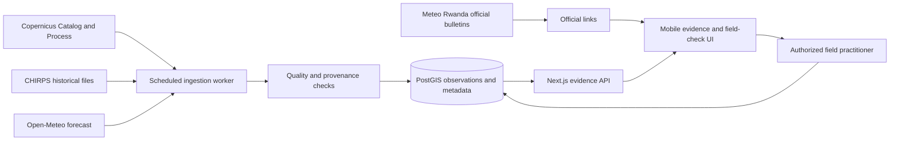

> **Superseded infrastructure details:** [Implementation architecture](09-implementation-architecture.md) is authoritative for SQLite-first storage, PostgreSQL 18 substitution, agents, jobs and feature layout. Retain this document for product workflow context; references below to PostgreSQL-first, PostGIS or S3 as required infrastructure are historical and not current decisions.

# System design and decisions

Status: proposed, 27 October 2026. The first pilot is one district and a few agreed areas, with a local practitioner and remote-sensing specialist. Neither district nor partners are confirmed. This is decision support, not an official warning service.

## Source-to-decision workflow

1. Store authorized area boundary and provenance, date, coordinate reference system and permitted use. Use coarse area aggregation in the pilot; do not claim field-level detail for small farms. Area choice and consent are separate from browser geolocation.
2. Worker uses Copernicus OAuth client credentials (server-only), Catalog search and Process API for Sentinel-2 L2A B04/B08, SCL and dataMask. Filter cloud/shadow/no-data pixels and apply an expert-reviewed land-cover policy; avoid treating a scene's tile cloud percentage as the area's valid-pixel fraction. NDVI = (B08 − B04)/(B08 + B04); exclude zero denominators. Capture scene ID, scene timestamp, valid-pixel proportion, mask, processing version, area, scale and aggregation method. For each period, show `insufficient coverage` rather than infer missing values; select a coverage threshold with experts and record it as a versioned policy, not an established scientific fact.
3. Download CHIRPS release files for the historical baseline and document version, spatial resolution, units, period, license and lag. Aggregate complete periods over area using a reproducible script; compare like seasons with explicit baseline years and valid coverage. Revisions create a new source version. No historical estimate is a current official alert.
4. Retrieve an Open-Meteo forecast for a declared representative coordinate. Store model/provider attribution, time retrieved, forecast valid times and units. Mark expired forecasts stale according to a policy chosen for the pilot. Free endpoint is non-commercial; verify terms, attribution and operational cost before launch. Link Meteo Rwanda's official forecasts; do not assume API access or permission for automated ingestion.
5. Show observations, historical context, forecasts and local reports as separate categories. A practitioner records an observation, date and follow-up. A model can only summarize structured, source-linked facts; schema checks must reject invented numbers and missing citations. No risk score or trigger until domain experts approve the rule and retrospective evaluation has measured errors. If cloud or upstream failure prevents comparison, display the absence and next action.

## Contracts and operational behavior

Conceptual records: `areas(id, name, geometry, provenance, version)`, `source_runs(id, provider, source_version, fetched_at, status)`, `observations(area_id, period_start, period_end, metric, value, units, valid_fraction, source_run_id, processing_version)`, `forecasts(area_id, issued_at, valid_at, value, units, source_run_id)`, `field_checks(area_id, author_id, observed_at, note, disposition)`, `jobs(id, state, lease_until, attempts, idempotency_key)` and `audit_events`. Original source artifacts and metadata are retained according to license and an approved policy. A missing value is null with a reason, never zero.

Proposed endpoints: `GET /api/areas`, `GET /api/areas/:id/evidence?from=&to=`, `POST /api/areas/:id/field-checks`, and `GET /api/sources/:id`. Validate date ranges and geometry, authorize each field-check write and redact private details in exports. Roles: viewer reads approved aggregate evidence; practitioner writes and edits own checks; coordinator reviews; administrator manages areas and providers. Drafts and assignments must not be visible to unauthorized users. Idempotent jobs, retries with backoff, timeouts, dead-letter state and alerts for stale data prevent silent failures. Cache a labelled last-known-good result only with its actual timestamps; don't serve it as current.

## Decisions still open

Pilot boundary, sufficient coverage and aggregation choices, historical baseline, source rights and budgets, actual official-bulletin access, field-check ownership, staffing, authorization, privacy and retention policies. These need local expertise and an operational agreement before use.
