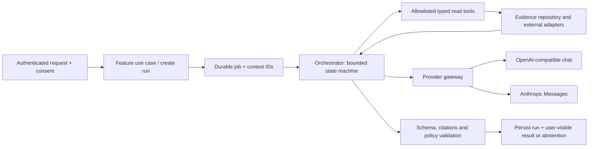

# Implementation architecture: shared contract, independent repository

Status: design, not implemented. Each application is a separate repository, process, database and deployment. This document intentionally specifies the same concepts in each repo; do not create a monorepo, cross-repository imports or an independently deployed common service. Reuse within each project through one implementation of each abstraction; do not duplicate a provider client per feature.

## Structure and dependency direction

```text
app/                            # Next App Router: layouts, pages, route handlers only
  (public)/                     # user-facing routes
  (admin)/admin/                # protected operational routes
  api/                          # HTTP validation and request/response mapping
features/<feature>/
  components/ hooks/            # UI in its feature; hooks never access server secrets
  server/                       # use cases and orchestration, authorization
  domain/                       # schemas, types, pure policies
  repositories/                 # ports + feature-owned DB adapters
server/
  db/                           # connection factory, transactions, migrations
  ai/                           # one provider gateway, tool loop, schemas, policy
  jobs/                         # durable queue, worker and scheduler
  auth/ config/ storage/         # cross-cutting ports + validated configuration
components/ui/                  # source-owned shadcn primitives
```

Dependencies point inward: route -> feature use case -> domain/repository ports -> DB/provider adapters. `server-only` modules cannot be imported by client components; secrets and provider credentials stay server-side. React hooks handle UI state, optimistic UI only where recoverable, and cancellation. Request validation and output schema validation use a single runtime validation library such as Zod; HTTP schemas map to use-case inputs rather than database rows. Separate server actions and route handlers only where they add value; no business logic in `app/`. Use React server components for initial reads where feasible and client components for interactive surfaces. Explicit Node runtime for SQLite/native drivers; no edge deployment. Store objects via a storage port (local private filesystem for development; optional S3 adapter later); DB rows store opaque keys, never public URLs.

## Database decision and migration discipline

SQLite is the local default. Plan Kysely with `better-sqlite3` and `pg` dialects, one typed repository contract and dialect-specific SQL migrations; verify actual installed versions, native build and Node/Next compatibility before locking. A dialect-neutral query builder does **not** make SQL syntax, migrations, locks or types portable automatically. Isolate incompatible operations behind repositories. Node 20+ is the existing project's minimum; pin an actively supported Node release after checking driver constraints. SQLite init per connection: enable foreign keys, WAL on a local filesystem, a bounded busy timeout; short transactions, one local worker, no network calls inside locks. SQLite permits one concurrent writer and WAL requires same-host shared memory ([SQLite WAL](https://www.sqlite.org/wal.html)); do not run multi-host workers against a SQLite file or assume serverless ephemeral disk persists. Back up with SQLite's online backup mechanism or coordinated checkpoint; never copy only a live `.sqlite` file, because WAL contains committed state.

Use portable primary IDs as UUID strings, UTC ISO timestamps, enums as checked text, boolean flags with normalized mapping, and JSON stored as validated text with application serialization. Foreign-key, unique, cascade behavior and transaction semantics must match on both engines. Money or precision-sensitive values use integer minor units/scaled integers; no float equality. Document ordering and case-insensitive matching explicitly. Use SQL parameters; never interpolate untrusted input. No required PostGIS, pgvector, SQLite FTS or DB-specific JSON queries in the MVP. Climate boundaries are validated GeoJSON and bounding boxes stored as text/numbers; geospatial processing happens through a provider or an isolated service port, not unvalidated custom SQL. Add spatial extensions only as an optional adapter after explicit migration and parity decisions.

Maintain separate versioned SQLite and PostgreSQL migrations with equivalent constraints and a shared migration manifest; migrations run explicitly, never automatically from a web request. Create a repository contract suite run against a temporary SQLite file and a disposable PostgreSQL 18 database, covering constraints, rollback, IDs, time, pagination, concurrent job claims, tenant/owner isolation and migrations. DB selection via `DB_PROVIDER=sqlite|postgres`; sqlite uses `SQLITE_PATH`, postgres uses `DATABASE_URL`. Switching configuration does not transfer data. Provide an explicit offline migration/export/import command, preserve IDs, validate schema version, row counts and checksums, reconcile references, verify an isolated target, and retain a tested rollback backup. Do not allow simultaneous source/target writes. Never reset or remove existing volumes as a setup shortcut.

### Local Postgres 18

`cp .env.postgres.example .env.postgres`, replace the placeholder with a local secret, then `docker compose --env-file .env.postgres -f compose.postgres.yml up -d`. Loopback-bound ports and separate volume names are project-scoped by Compose directory; use distinct ports 55431/55432 by default. Set `DB_PROVIDER=postgres` and a URL with the same database/user/password in `.env.local`; URL-encode reserved password characters. Image initialization variables only affect an empty volume; changing them later does not update an existing user. Mount `/var/lib/postgresql`, not the older path: [official PostgreSQL image notes](https://hub.docker.com/_/postgres) explain the 18+ layout. Add migrations and health checks before expecting app connectivity. Secrets, local DB files, and uploads are ignored. Compose/env are preparation only: neither engine adapter nor migration exists yet, and Docker access was denied in this environment.

## Bounded AI orchestration

Only two configurable external provider families: `openai-compatible` (explicit Chat Completions-compatible endpoint, URL/model/key) and `anthropic` (Messages API). `disabled` is the safe default and a deterministic fake is test-only, not a third external provider. Model identifiers, tool-call support, JSON output and image support are configuration/capability checks, not assumed for every compatible endpoint. If the selected endpoint lacks an image capability, require text-only or return a clear unsupported state; do not silently discard the attachment. Local and remote endpoints need explicit allowlisted hosts, TLS except explicitly permitted localhost in development, redirect restrictions, DNS/IP validation, no credentials in logs, timeouts, token budget and cancellation. Treat a configured compatible server as a data recipient and obtain appropriate user consent; require service-side access restrictions for any configuration UI. `AI_PROVIDER`, `AI_MODEL`, `AI_BASE_URL`, `AI_API_KEY`, `AI_ALLOWED_HOSTS`, `AI_TIMEOUT_MS`, `AI_MAX_OUTPUT_TOKENS` are server-only; map them to a validated discriminated union and validate URL/provider compatibility at boot. Never treat environment keys as client-side settings.



Canonical internal protocol: `Message {role, content[]}` where content is text, image reference, tool-call or tool-result; `ToolDefinition {name, inputSchema, authorize, execute}`; `ProviderCapabilities {vision, toolCalls, structuredOutput}`; `ModelProvider.generate(request, signal) -> {content, toolCalls, usage, finishReason}`; `AgentRun {id, workflow, status, step, attempt, deadline, inputRefs, outputRef, provider, model, promptVersion, policyVersion, errorCode}`. Typed structured `EvidenceRef {sourceId, version, observedAt, validUntil, areaOrScope, confidenceOrQuality, citationUrl}` stays attached to tool results. Translate protocol separately per adapter: OpenAI-style tool calls vs Anthropic `tool_use` and `tool_result`; [OpenAI function calling](https://developers.openai.com/api/docs/guides/function-calling) and [Anthropic tool loop](https://platform.claude.com/docs/en/agents-and-tools/tool-use/how-tool-use-works) differ in wire format. OpenAI-compatible vendors may only implement subsets: contract-test the actual configured endpoint; never assert universal compatibility.

Orchestrator stages: (1) input/authorization/consent and safety gate; (2) collect minimum structured context, return `needs_input` if missing; (3) deterministic retrieval of eligible, reviewed evidence and limited read-only tool execution; (4) model synthesis, bounded to configured turns/calls/time/cost; (5) validate JSON/schema, citations against allowed evidence, policies and freshness; (6) persist a result with explicit uncertainty, `needs_review`, `abstained` or `failed`. The model proposes; deterministic code authorizes every tool and owns state. No unrestricted shell, SQL, web browsing, arbitrary URLs, direct messages or autonomous writes. Treat prompt, images and retrieved text as untrusted data; ignore tool instructions inside them. Validate tool args, actor/object permissions and response length; escape HTML, sanitize sources, use fixed egress hosts. Client-triggered cancellation sets durable cancellation; reject late results. Each external call has timeout, bounded retries only for retryable failures, exponential backoff and idempotency; never retry an unsafe side effect or duplicate persistence.

## Jobs, security and operations

DB-backed outbox and job table: creation and enqueue are one transaction. `queued -> leased -> succeeded|failed|cancelled`, with `lease_until`, worker ID, attempts, idempotency key and visibility timeout; recover expired leases, protect terminal updates with conditional claims and a fencing/attempt token, avoid claiming more work than capacity. SQLite claim uses a short atomic write transaction; Postgres claim uses a transaction with row locking (e.g. `FOR UPDATE SKIP LOCKED`), verified by multi-worker tests. At-least-once execution means tool handlers and persistence must be idempotent; cancellation races and duplicate events require tests. Worker and web process run independently when deployed; SQLite worker must run on same host/local volume. Startup migration, health/readiness, graceful shutdown and stale/failed-job visibility are required. Limits: configurable per-user/day and provider cost ceiling, payload sizes, queue depth, resource timeouts. Audit events contain actor, action, time, object ID, outcome and trace ID, no secrets, photos or raw sensitive prompt. Auth must enforce user ownership and admin/reviewer roles server-side; no insecure development login in production. Consent, encryption, retention/deletion, backup/restore and local legal review are release gates. Do not claim browser encryption or secure backup until implemented.

## Ijuru Signal feature and agent topology

Features: `locations` (approved areas, boundaries and provenance); `hazards` (non-predictive categories and official links); `forecasts` (provider fetch and freshness); `observations` (satellite and historical data); `field-checks` (authorized notes); `evidence` (source catalog and quality); `analysis` (bounded summary); `admin` (source runs, queue, audit). Routes: `/` location and hazards, `/areas/[id]`, `/admin`, `/admin/field-checks`, `/admin/sources`; APIs `/api/areas`, `/api/areas/[id]/evidence`, `/api/areas/[id]/field-checks`, `/api/analysis/[id]`; authorize every read/write. Prototype `index.html` is the user reference; `dashboard.html` is the admin concept. No data means explicit unavailable, never zero, safe or green.

Workflow `location-brief/v1`: resolve approved area and date -> independently collect authorized `weather.get`, `observations.get`, `rainfall.history` and `official.links` through code-owned adapters -> evaluate deterministic freshness/coverage and reject insufficient source records -> optional model synthesis of only eligible evidence -> verify every source ID, timestamp, numeric claim and category -> output or abstain. Do not ask the model to retrieve arbitrary web pages or generate a risk score. These are coordinated stages of one run, not separate duplicated model agents. A location may show a link to an official source, but must never claim a live official alert feed unless permission and integration exist. Reference URLs are configured, not user-submitted arbitrary fetches.

Output `LocationBrief`: `areaId`, `asOf`, `forecast[]`, `observations[]`, `historicalContext[]`, `coverageGaps[]`, `officialLinks[]`, `verificationSuggestions[]`, `status: ready|partial|unavailable`, with each item containing source IDs and validity/quality metadata. Deterministic numeric and citation checks must compare against exact evidence records; if verification is impossible, suppress the statement rather than displaying invented claims. Flood, landslide and drought products are unvalidated hypotheses; no real warning, severity level or prediction until domain-approved source, rules and evaluation exist. Optional explanations must not block basic source views when AI is disabled.
